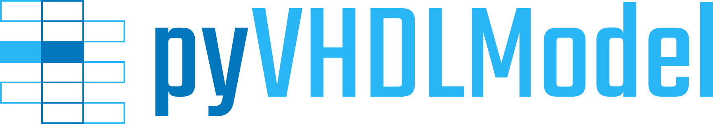

.. raw:: latex

   \part{Introduction}

.. shields::
   :github:                VHDL/VHDLDomain
   :pypi:                  VHDLDomain
   :codacy:                2286426d2b11417e90010427b7fed8e7
   :gitter:                hdl/community
   :source-license:        github:LICENSE.md
   :documentation-license: CC-BY-4.0 github:doc/Doc-License.rst
   :github-action:         Pipeline.yml@main
   :documentation:         github-pages

   github, src-license, ghp-doc, doc-license, gitter
   pypi-tag, pypi-status, pypi-python
   github-action, lib-status, codacy-quality, codacy-coverage, codecov-coverage

--------------------------------------------------------------------------------

The VHDLDomain Documentation
############################

A Sphinx domain providing VHDL language support.

.. _GOALS:

Main Goals
**********

This sphinx extension adds a new language domain to Sphinx. It allows the documentation of VHDL source files.

Use Cases
*********

* Partial or fully automated documentation of VHDL designs.

.. _CONTRIBUTORS:

Contributors
************

* :gh:`Patrick Lehmann <Paebbels>` (Maintainer)
* :gh:`and more... <VHDL/VHDLDomain/graphs/contributors>`

.. _LICENSE:

License
*******

.. only:: html

   This Python package (source code) is licensed under `Apache License 2.0 <License.html>`__. |br|
   The accompanying documentation is licensed under
   `Creative Commons - Attribution 4.0 (CC-BY 4.0) <Doc-License.html>`__.

.. only:: latex

   This Python package (source code) is licensed under **Apache License 2.0**. |br|
   The accompanying documentation is licensed under **Creative Commons - Attribution 4.0 (CC-BY 4.0)**.

.. toctree::
   :hidden:

   Used as a layer of EDA² ➚ <https://edaa-org.github.io/>

.. toctree::
   :caption: Introduction
   :hidden:

   News
   GettingStarted
   Installation
   Dependency

.. raw:: latex

   \part{Main Documentation}

.. toctree::
   :caption: Main Documentation
   :hidden:

   Configuration/index
   Directives/index
   Roles/index
   Indices/index

.. raw:: latex

   \part{References and Reports}

.. toctree::
   :caption: References and Reports
   :hidden:

   Python Class Reference <VHDLDomain/VHDLDomain>
   unittests/index
   coverage/index
   Doc. Coverage Report <doccoverage/index>
   Static Type Check Report ➚ <typing/index>

.. raw:: latex

   \part{Appendix}

.. toctree::
   :caption: Appendix
   :hidden:

   License
   Doc-License
   Glossary
   genindex
   Python Module Index <modindex>
   TODO
